.. _transfer:

文件传输
========

用户数据存储空间
-------------------

.. _project-data:

在cnSRC上，系统根据使用模式为用户在共享文件系统上分配三种目录，分别是个人目录，项目目录和公共集群目录。

在实例或集群中，这三种目录所对应的路径不同，具体见下表：

.. csv-table:: 
   :header: "", "个人目录", "项目目录", "公共集群目录"
   
   容器实例,/home/username,/group_homes/<project>/home/username,/group_homes/public_cluster/home/username
   虚拟机实例,/webdav/MyData,/webdav/ProjectGroup(<project>),/webdav/ProjectGroup(public_cluster)
   公共集群,/users/username,/groups/<project id>/home/username,/home/username
   Web文件管理,个人家目录,项目组目录（选择相应项目组）,项目组目录（如有public_cluster选项）

.. attention:: 

   username请替换为自己的用户名（这个信息可以在“我的信息”-“基本信息”中查询）。
   
   <project id>请替换为"g+项目ID"（项目基本信息中查询项目ID），例：项目ID为700008，则替换为“g700008”。
   
   <project>请替换为项目名（项目基本信息中查询。）

.. note::

   Web文件管理通过“个人家目录”和“项目组目录”切换数据位置。
   页面顶部显示的是当前浏览位置，不应直接作为实例或集群中的文件系统路径使用。

Web文件管理与数据传输
--------------------

登录麒麟平台后，点击左侧菜单 **文件管理**，或直接打开
`文件管理页面 <https://kylin.cnsrc.shao.ac.cn/File/>`__，
即可浏览目录、搜索文件、新建文件夹，以及上传和下载文件。

选择数据目录
~~~~~~~~~~~~~~~~

- **个人家目录**：点击此按钮返回个人存储空间，页面顶部显示 ``~/``。
- **项目组目录**：展开下拉列表，选择需要访问的项目组。页面顶部显示对应的项目组目录，
  例如 ``test_project/``；进入其 ``data`` 子目录后显示 ``test_project/data/``。

操作前先核对页面顶部的路径，确保上传文件或新建文件夹的位置正确。
项目组目录的可选项以当前账号页面中显示的列表为准。

文件列表包含 **文件名**、**文件大小**、**上次修改时间** 和 **操作** 四列，
可通过名称旁的文件夹图标或文件图标区分目录和文件。

   项目组目录示例：顶部显示当前路径，下方为目录切换入口、工具栏和文件列表。

浏览和搜索文件
~~~~~~~~~~~~~~~~

1. 点击文件夹名称，进入该子目录；点击 **返回上一级** 返回父目录。
2. 在 **搜索文件** 输入框中输入文件名关键字，点击右侧放大镜按钮，筛选当前目录中的条目。
3. 清空搜索框并再次点击放大镜按钮，可恢复当前目录的完整列表。
4. 文件较多时，使用列表底部的页码或左右箭头切换分页。

新建文件夹
~~~~~~~~~~~~~~~~

1. 进入目标目录，点击工具栏中的 **新建文件夹**。
2. 在弹出的对话框中输入文件夹名称，点击 **OK**。
3. 检查当前列表中是否出现新文件夹；如需放弃创建，点击 **Cancel** 或右上角关闭按钮。

上传文件
~~~~~~~~~~~~~~~~

1. 进入需要保存文件的个人目录或项目组目录，点击工具栏中的 **上传文件**。
2. 在弹出的对话框中，再次点击 **上传文件**，通过本地文件选择窗口选择文件。
3. 查看上传窗口中的状态及提示，按界面提示完成操作并关闭窗口。
4. 回到文件列表，核对文件名和文件大小，确认文件已出现在预期目录。

   上传文件对话框；其中的“上传文件”按钮用于选择本地文件。

.. note::

   当前上传窗口的文件选择控件每次只允许选择一个本地文件，多个文件需逐个操作。
   文件大小或数量限制、失败原因以实际上传时的平台提示为准。

下载文件
~~~~~~~~~~~~~~~~

进入文件所在目录，点击文件名称下载，并在浏览器中查看下载进度和保存位置。
文件夹名称用于进入目录；如需传输整个目录，可使用下文介绍的SSH传输方式。

删除与操作注意事项
~~~~~~~~~~~~~~~~~~~~

文件列表 **操作** 列中的红色 **×** 为删除入口。
删除前应核对当前目录和目标名称，并提前备份重要数据；
项目组目录中的操作还需确认不会影响其他成员使用的数据。

.. caution::

   不要随意删除或覆盖个人目录中的配置文件（例如 ``.bashrc``、``.ssh`` 中的文件）。
   上传失败或文件未出现在列表中时，先检查当前路径、搜索条件、网络连接和页面错误提示，
   确认原因后再重试，避免重复传输或误操作。

通过ssh账户传输
-------------------

.. _public_cluster_data: 

由于Web传输文件功能有限，对于开放了SSH端口的集群或实例，用户可以通过SSH账户使用scp类的工具来传输数据。

|image4|

以公共集群项目为例，用户在 **项目** -> *public cluster* 的页面里，选择 **实例** ，点击实例最右侧的SSH服务地址按钮，会弹出cnSRC对外开放的IP地址和端口：

|ssh ip|

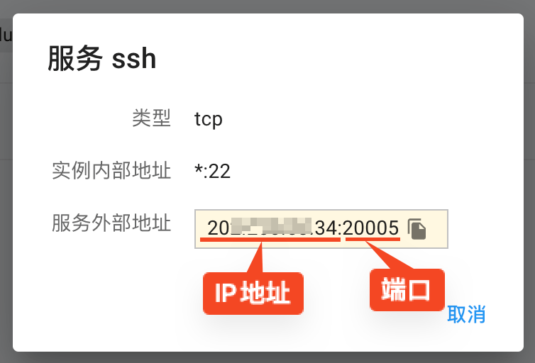

首次使用SSH登录的用户需要 :ref:`重置cnSRC密码 <reset password>`

|reset_pw|

用户在能够直接访问cnSRC服务IP地址的情况下，可以使用scp、\ `WinSCP <https://winscp.net/eng/docs/lang:chs>`__\ 或\ `Xmanager <https://www.netsarang.com/en/xmanager/>`__\ 等scp工具来传输数据：

.. code:: bash

   scp -P 20139 some_data user@ssh_ip:/home/USERNAME/

使用XFTP传输
~~~~~~~~~~~~~~~~

Windows用户也可以使用\ `XFTP <https://www.xshellcn.com/xftp.html>`__\ 客户端进行传输。

1. 下载并安装XFTP软件后打开，点击“文件”-“新建”。

   |new xftp connection|

   .. |new xftp connection| image:: ../../_static/transfer_new_xftp_connection.png

2. 名称用户可以自定义，主机选项中输入“服务ssh“显示的服务外部地址，端口号填写“服务ssh”中的端口号，协议使用默认的SFTP，用户名和密码填写cnSRC的用户名和密码。点击”连接“。

   |set xftp connection|

   .. |set xftp connection| image:: ../../_static/transfer_set_xftp_connection.png

3. 连接后左侧为当前用户计算机的视图，右侧为远程计算机的视图，用户访问的远程计算机路径为\ ``/home/username``\ ，即当前用户的家目录，用户可将文件从个人电脑上传输到共享文件夹内，下方传输栏会显示传输任务详细信息。

   |xftp windows|

   .. |xftp windows| image:: ../../_static/transfer_xftp_windows.png

4. 传输完成后即可在公共集群或实例控制台的用户家目录中看到刚才传输的文件。

   |file in terminal|

   .. |file in terminal| image:: ../../_static/transfer_file_in_terminal.png

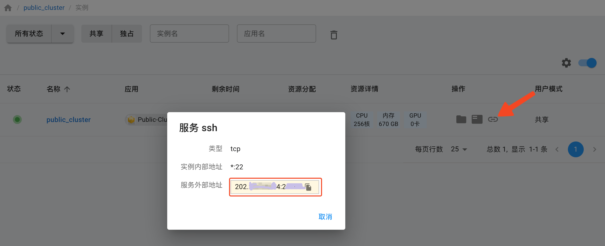
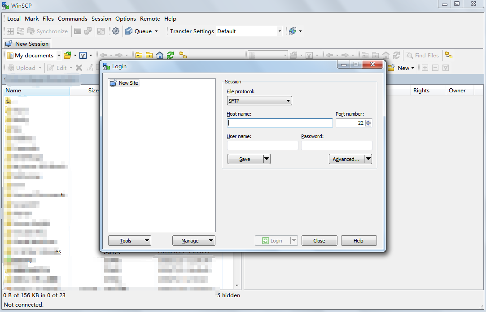
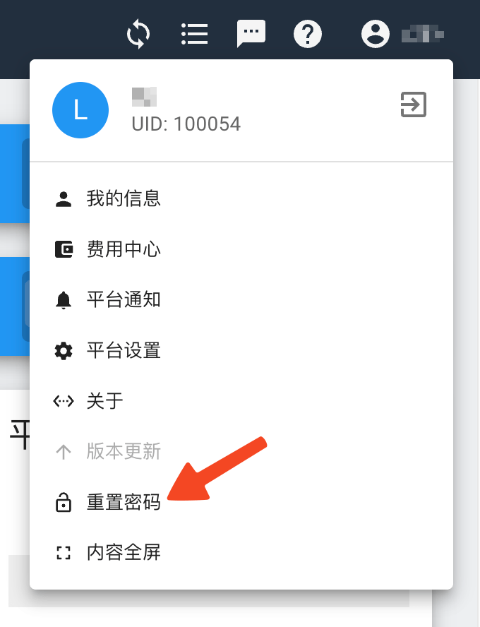
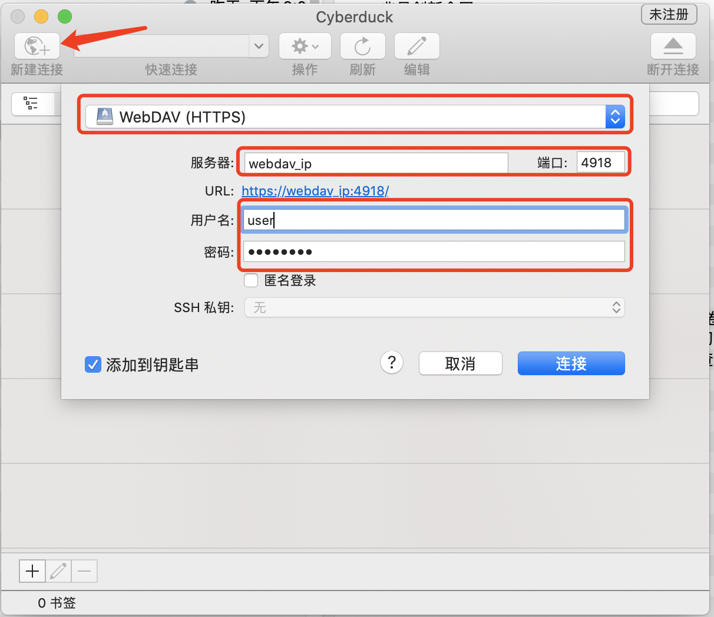
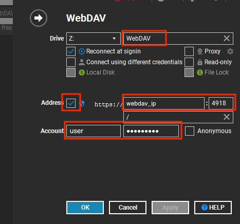
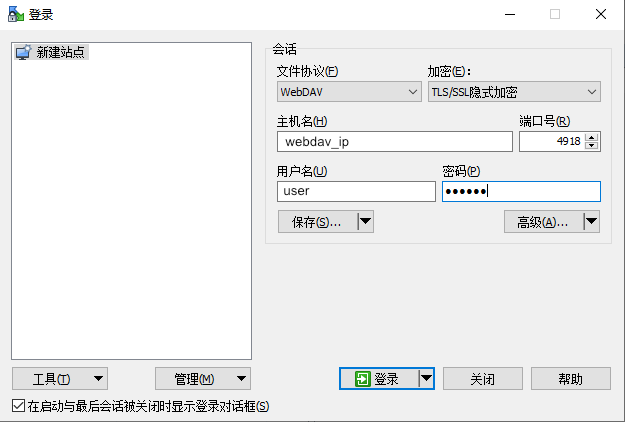
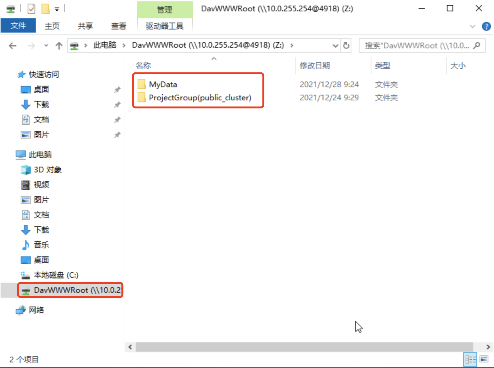
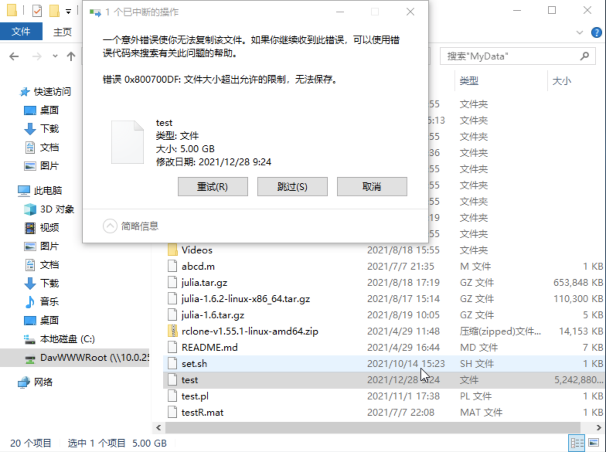
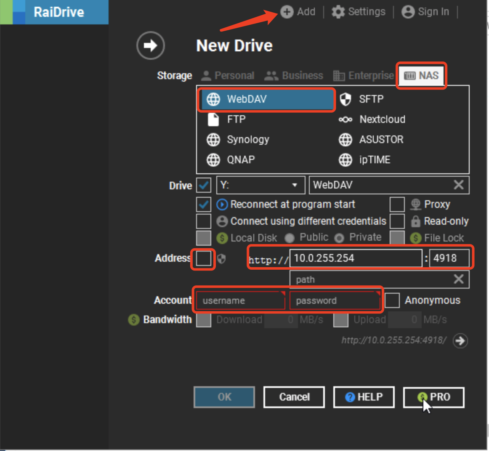
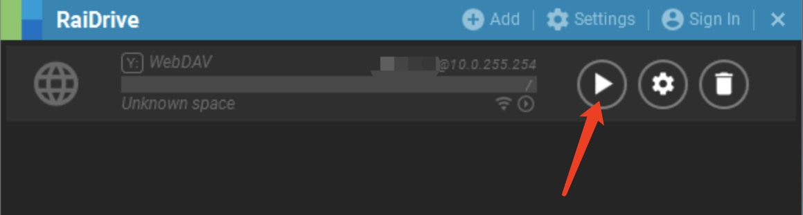
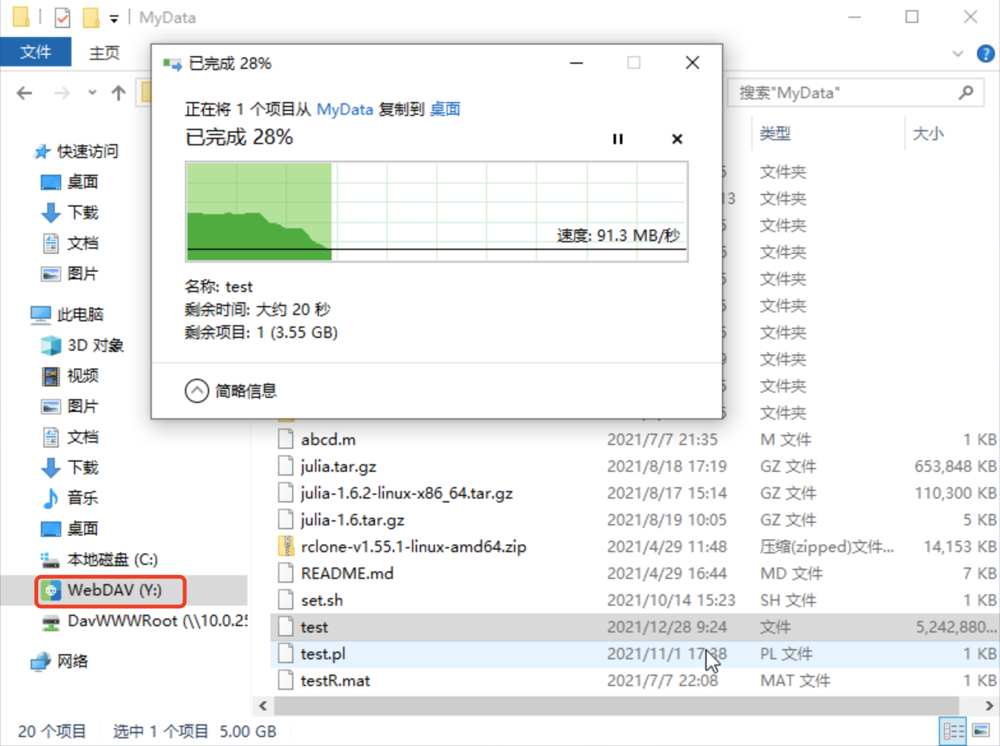
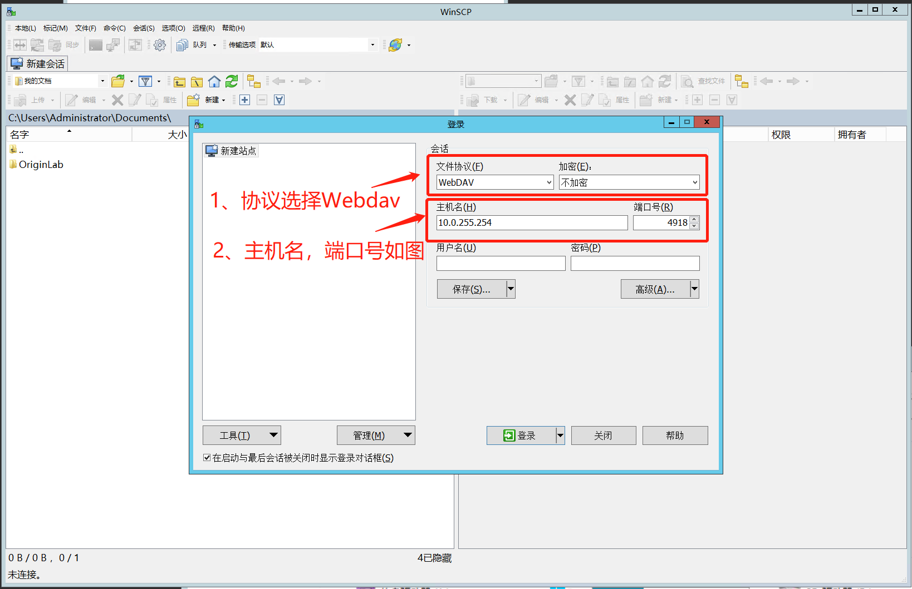
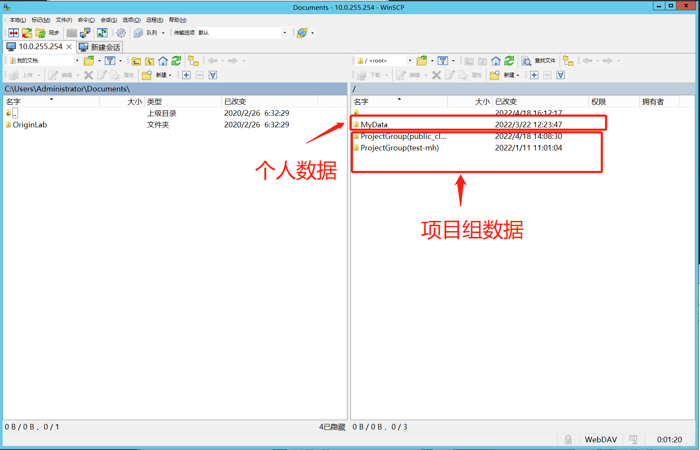
